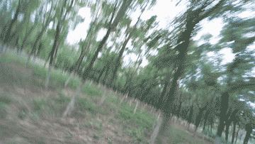
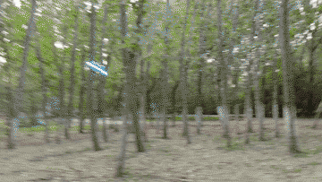
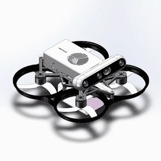
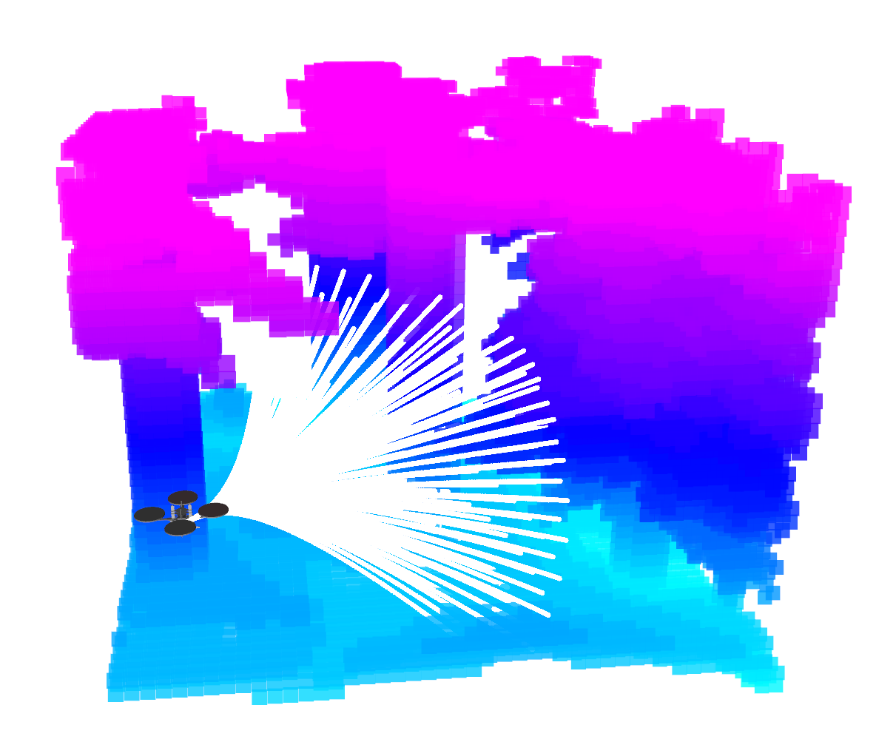
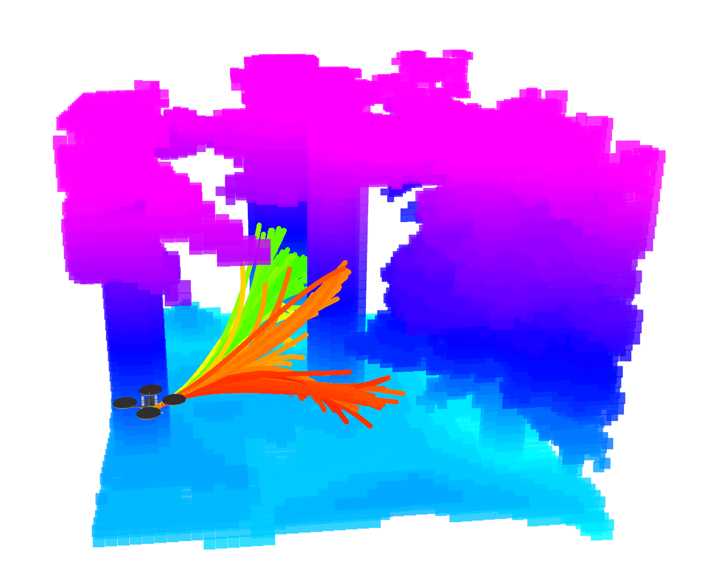
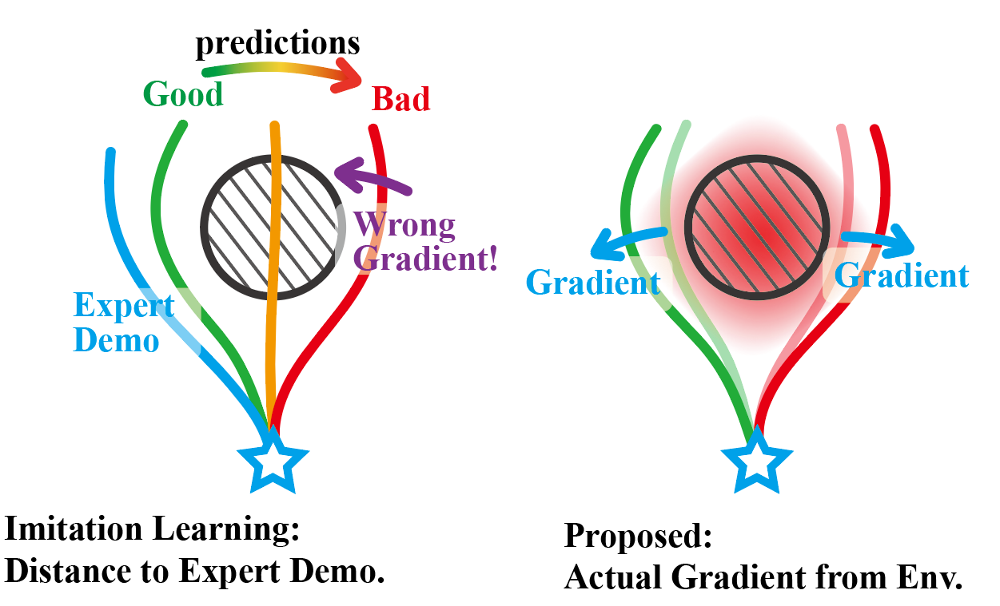
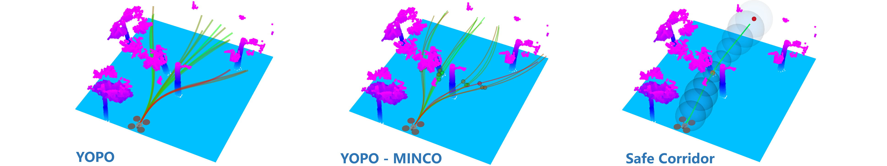

# You Only Plan Once

Original Paper: [You Only Plan Once: A Learning-Based One-Stage Planner With Guidance Learning](https://ieeexplore.ieee.org/document/10528860)

Improvements and Applications: [YOPOv2-Tracker: An End-to-End Agile Tracking and Navigation Framework from Perception to Action](https://arxiv.org/html/2505.06923v1)

Video of the paper: [YouTube](https://youtu.be/m7u1MYIuIn4), [bilibili](https://www.bilibili.com/video/BV15M4m1d7j5)

Some realworld experiment: [YouTube](https://youtu.be/LHvtbKmTwvE), [bilibili](https://www.bilibili.com/video/BV1jBpve5EkP)

<table>
  <tr>
    <td align="center" width="38.5%"></td>
    <td align="center" width="38.5%"></td>
    <td align="center" width="23.0%"></td>
  </tr>
</table>

### Hardware:

Our drone designed by [@Mioulo](https://github.com/Mioulo) is also open-source. The hardware components are listed in [hardware_list.pdf](hardware/hardware_list.pdf), and the SolidWorks file of carbon fiber frame can be found in [/hardware](hardware/) (complete assembly files are included in the [Release](https://github.com/TJU-Aerial-Robotics/YOPO/releases/tag/hardware)).

## Introduction:

We propose **a learning-based planner for autonomous navigation in obstacle-dense environments** which integrates (i) perception and mapping, (ii) front-end path searching, and (iii) back-end optimization of classical methods into a single network.

**Learning-based Planner:** Considering the multi-modal nature of the navigation problem and to avoid local minima around initial values, our approach adopts a set of motion primitives as anchor to cover the searching space, and predicts the offsets and scores of primitives for further improvement (like the one-stage object detector YOLO).

**Training Strategy:** Compared to giving expert demonstrations as labels in imitation learning or exploring by trial-and-error in reinforcement learning, we directly back-propagate the gradients of trajectory costs (e.g. from ESDF) to the weights of network, which is simple, straightforward, accurate, and sequence-independent (free of online simulator interaction or rendering).

<table>
    <tr>
        <td align="center" style="border: none;"></td>
        <td align="center" style="border: none;"></td>
		<td align="center" style="border: none;"></td>
    </tr>
    <tr>
        <td align="center" style="border: none;">primitive anchors</td>
        <td align="center" style="border: none;">predicted traj and scores</td>
		<td align="center" style="border: none;">learning method</td>
    </tr>
</table>

### Updates

- **[2026-08-14]** We adopt [MINCO](https://github.com/ZJU-FAST-Lab/GCOPTER) as YOPO's trajectory representation, along with several other improvements. Please refer to the [YOPO-MINCO](https://github.com/TJU-Aerial-Robotics/YOPO/tree/YOPO-MINCO) branch. A simple comparison:

<p align="center">
    
</p>

- **[2025-6-17]** The code is greatly simplified and refactored in Python/PyTorch. We also replaced the simulator with our CUDA-accelerated randomized environment, which is faster, lightweight, and boundless. For the stable version consistent with our paper, please refer to the [main](https://github.com/TJU-Aerial-Robotics/YOPO/tree/main) branch.

---

## ROS 2 Humble Deployment

This checkout has been migrated to **ROS 2 Humble / Ubuntu 22.04**. It includes
both control modes, the CUDA/CPU sensor simulator, data collection, the planner,
and RViz 2. The original network, weights, trajectory representation, and
controller equations are retained.

See [README_ROS2.md](README_ROS2.md) for dependencies, launch options, training,
Jetson/MAVROS integration, and verification.

From the workspace root, using the existing Python 3.10 `yopo_ros2` environment:

```bash
bash scripts/build_ros2.sh
bash scripts/run_simulation.sh
```

For the position controller:

```bash
bash scripts/run_simulation.sh controller_mode:=position
```

The build uses system Python for ROS interface generation. The run script uses
`~/miniconda3/envs/yopo_ros2/bin/python` for planner inference when available.
Set `YOPO_PYTHON` to select another compatible environment.

Simulation settings remain in [config.yaml](Simulator/src/config/config.yaml)
and planner/training settings in [traj_opt.yaml](YOPO/config/traj_opt.yaml).
Pretrained weights are at `YOPO/saved/YOPO_1/epoch50.pth`.

## Train The Policy

```bash
source /opt/ros/humble/setup.bash
source install/setup.bash
ros2 run sensor_simulator dataset_generator

conda activate yopo_ros2
cd YOPO
python train_yopo.py
```

Dataset generation replaces the output directory. See the ROS 2 guide before
collecting data into an existing dataset. Training and costs retain the original
implementation.

## TensorRT Deployment

TensorRT/torch2trt are optional and must be installed for the target Jetson.
Generate the engine on that device:

```bash
cd YOPO
python yopo_trt_transfer.py --trial=1 --epoch=50
```

Pass `use_tensorrt:=true weight:=/absolute/path/yopo_trt.pth` to the ROS 2 planner
launch. Camera settings, NWU odometry, hover thrust, and gains must match the
actual vehicle. See [Jetson deployment](README_ROS2.md#jetson-deployment).

## Finally

We are still working on improving and refactoring the code to improve the readability, reliability, and efficiency. For any technical issues, please feel free to contact me (lqzx1998@tju.edu.cn) 😀 We are very open and enjoy collaboration!

If you find this work useful or interesting, please kindly give us a star ⭐; If our repository supports your academic projects, please cite our paper. Thank you!

```
@article{YOPO,
  title={You Only Plan Once: A Learning-based One-stage Planner with Guidance Learning},
  author={Lu, Junjie and Zhang, Xuewei and Shen, Hongming and Xu, Liwen and Tian, Bailing},
  journal={IEEE Robotics and Automation Letters},
  year={2024},
  publisher={IEEE}
}
```
