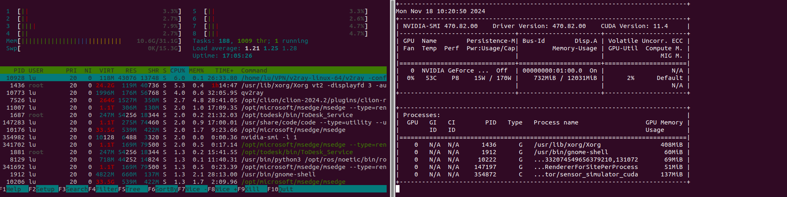
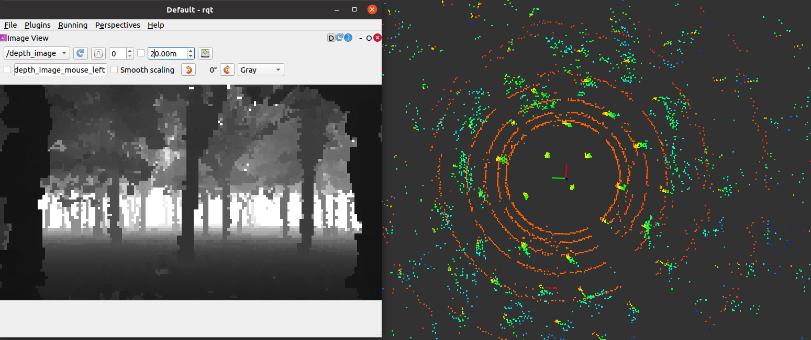
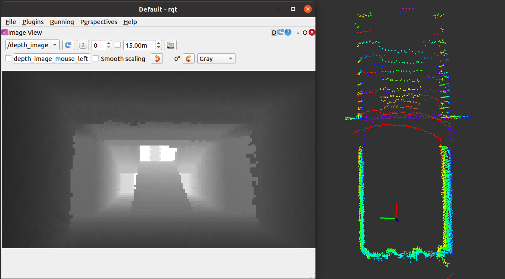
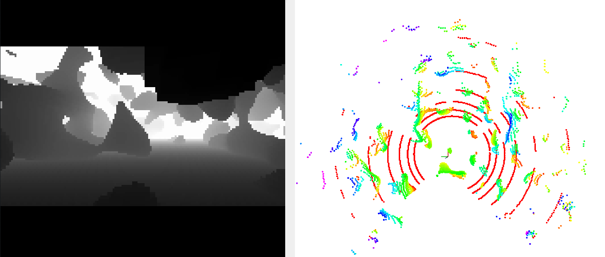
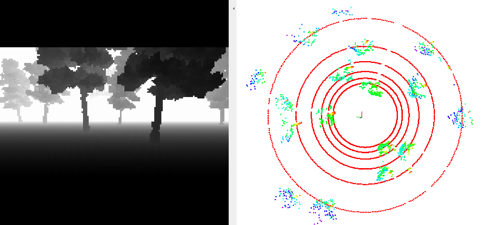
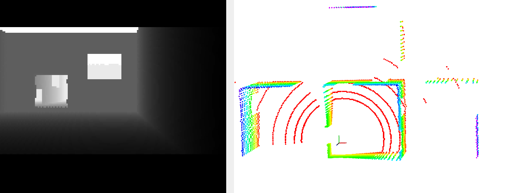
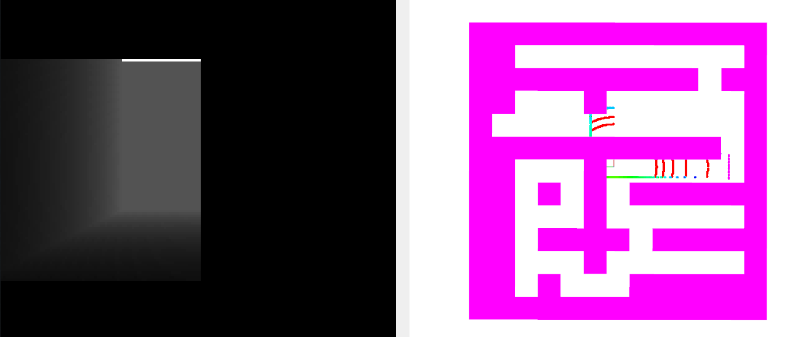

# ROS 2 Humble 点云/深度图仿真（支持 CUDA）

### 1 依赖

Ubuntu 22.04、ROS 2 Humble、OpenCV、PCL、yaml-cpp；GPU 版本还需要 CUDA。
```bash
sudo apt-get install ros-humble-cv-bridge ros-humble-pcl-conversions libyaml-cpp-dev
```

### 2 编译
从仓库根目录编译：
```bash
source /opt/ros/humble/setup.bash
colcon build --packages-select sensor_simulator --cmake-args -DCMAKE_CUDA_ARCHITECTURES=89
```
RTX 4060 使用架构 `89`；Jetson Orin 使用 `87`。无 CUDA 时只编译 CPU 版本：
```bash
colcon build --packages-select sensor_simulator --cmake-args -DENABLE_CUDA=OFF
```

### 3 运行
```bash
source install/setup.bash
# GPU版本 (推荐, RTX 3060 深度输出 > 1000fps)
ros2 run sensor_simulator sensor_simulator_cuda

# CPU版本 (资源占用高，仅供GPU编译失败无法解决时测试)
ros2 run sensor_simulator sensor_simulator
```

节点默认读取安装目录中的 `share/sensor_simulator/config/config.yaml`。通过参数覆盖配置：
```bash
ros2 run sensor_simulator sensor_simulator_cuda --ros-args -p config_file:=/absolute/path/config.yaml
```
点云路径相对配置目录或包目录解析，也兼容原有的 `src/pointcloud/tree.ply`。
`/sim/odom`、`/depth_image`、`/lidar_points` 使用 best-effort SensorData QoS；
`/mock_map` 使用 reliable + transient-local QoS，后加入的可视化节点也能收到地图。

传感器参数以及点云环境修改见[config](config/config.yaml)，重要参数说明:
```
# 一些话题
odom_topic: "/sim/odom"
depth_topic: "/depth_image"
lidar_topic: "/lidar_points"
# 使用预先构建的点云地图还是随机地图
random_map: true
# 随机地图配置
maze_type: 5   # 1: 溶洞 2: 柱子 3:迷宫 5:森林 6:房间
```

### 4 仿真位置发布与简单可视化（可选）
```bash
ros2 run sensor_simulator sim_odom.py
```

整套控制器、规划器和 RViz 2 启动方法见仓库根目录说明。

### 数据集生成

```bash
ros2 run sensor_simulator dataset_generator --config /absolute/path/config.yaml
```
生成器会**删除并重建 `save_path` 整个目录**。默认配置保留仓库的 `dataset/`
输出位置；自定义配置中的相对 `save_path` 相对该 YAML 所在目录解析。
绝对输出路径不变。先用小规模 `env_num` 和 `image_num` 检查配置，再生成完整数据。


### 5 实时性与资源占用

cpu 版本 (i7-9700)：
深度图0.02s, 点云0.01s

gpu 版本 (RTX 3060)：
深度图0.001s, 点云0.001s

GPU版资源占用(开30HZ)：


### 6 示例场景

<table>
  <tr>
    <td align="center">
      
      <p>1. realworld forest</p>
    </td>
    <td align="center">
      
      <p>2. realworld building</p>
    </td>
  </tr>
  <tr>
    <td align="center">
      
      <p>3. 3D perlin</p>
    </td>
    <td align="center">
      
      <p>4. random forest</p>
    </td>
  </tr>
  <tr>
    <td align="center">
      
      <p>5. random room</p>
    </td>
    <td align="center">
      
      <p>6. random maze</p>
    </td>
  </tr>
</table>

**注释:**

1. GPU版本地图无边界可无限延伸; CPU版本地图有边界（可选择复制地图几份，已弃用）

### acknowledgment

Some maps (3D Perlin, random maze) are generated based on: https://github.com/HKUST-Aerial-Robotics/mockamap, thanks for their excellent work!
